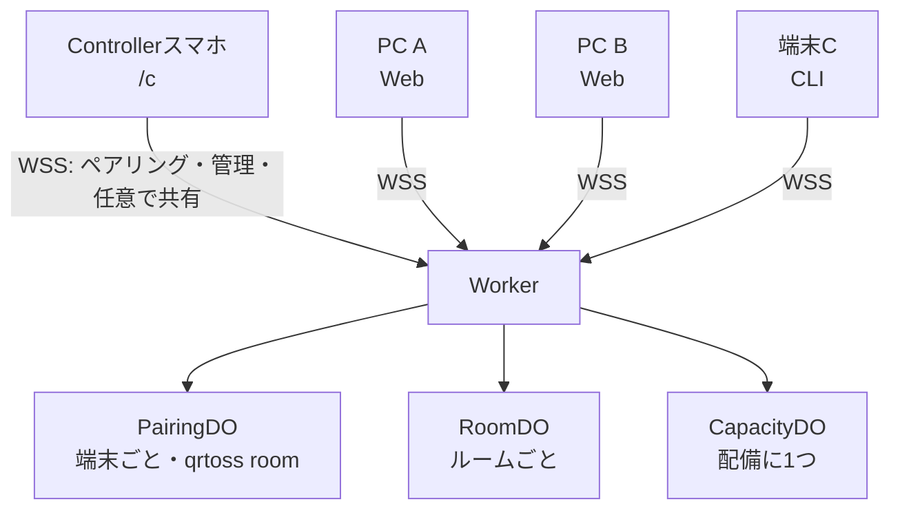

# qrnex — QRペアリングによる複数端末ファイル・メッセージ共有 仕様書

- バージョン: 4.0（DO中継・Controller紹介者モデル）
- 更新日: 2026-11-19
- 形態: OSS（MIT）/ Webアプリ + CLI / 中継サーバー（Cloudflare Workers + Durable Objects版、Node版）
- 基盤: qrtoss 0.4.0（`docs/spec.md` 1.1.0）。本書で定めない事項はqrtossの仕様に従う（以下「qrtoss §n」と表記）

本書の「必須」「禁止」「しなければならない」は受入条件である。「推奨」は理由を記録したうえで変更できる。「対象外」「将来」は初版の完了条件に含まない。v3.0からの変更点は付録Aにまとめる。

## 1. 目的

カメラのないPCを含む複数の端末を、スマートフォンで各端末のQRを読み取って一時的な共有ルームに参加させる。参加端末は、ファイルとテキストメッセージを参加中の**他の全メンバー**へ送信できる。

- 最初にQRを読み取ったスマートフォンだけがControllerとなり、端末の追加・強制切断・ルーム終了を行う。Controllerは任意で共有メンバーにもなれる。
- 本文は端末間で暗号化（E2EE）し、中継サーバーは暗号文だけを即時中継する。中継サーバーは本文を復号できず、保存もしない。
- Web版はインストール・アカウント登録不要。CLI版は対話プロンプトでFTPのように操作できる。

## 2. 規範的ユーザーフロー

1. PC A、PC B…で同じURL（`/`）を開くか、CLI `qrnex` を起動する。各端末は個別の短命なペアリング用QRを表示する。
2. スマートフォンの標準カメラで任意の端末のQRを読み、リンクを開く。そのページ（Controllerページ）が新規ルームを作成し、そのページだけがController権限を持つ。
3. ペアリングが成立すると、PCに**ルーム照合コード**（例：`K7QM-2XFD`）と参加確認が表示される。Controllerにも同じコードが表示される。一致を確認してPCで「参加」を押す（CLIは `y` を入力する）。
4. Controllerページの「別の端末を追加」でブラウザ内カメラを起動し、別の端末のQRを読む。必要な台数だけ繰り返す。
5. Controllerページの「このスマートフォンも参加」をオンにすると、スマートフォンも送受信メンバーになる（既定はオフ）。
6. 送受信メンバーが2台以上になると共有できる。どの端末からでも、ファイルの選択・ドラッグ＆ドロップやテキスト入力で送信でき、送信時点の他の全メンバーへ届く。
7. 端末の追加・強制切断・参加受付の停止・ルーム終了はControllerだけが操作できる。メンバーは自分の退出だけができる。

再接続は提供しない（第8.6節）。

- Controllerページを閉じる、再読み込みする、または通信が切れると、Controller権限は失われる。既存メンバー間の共有は続けられるが、端末の追加はできなくなる。
- メンバーの通信が切れると、そのメンバーは退出扱いになる。PCは新しいQRの表示に戻り、Controllerが残っていれば再び追加できる。

## 3. 機能要件

| ID | 要件 | 優先度 |
|---|---|---|
| FR-01 | 各端末が個別のペアリング用QRを生成し、失効時に更新する（qrtoss準拠、60秒） | 必須 |
| FR-02 | Controllerだけが、ブラウザ内カメラの連続スキャンで上限内の端末をルームに追加する | 必須 |
| FR-03 | 期限切れ・使用済みQR、同一端末の重複参加、上限超過を拒否する | 必須 |
| FR-04 | Controllerのスマートフォンが任意で送受信メンバーになれる | 必須 |
| FR-05 | ファイルを送信時点の他の全メンバーへ配信する | 必須 |
| FR-06 | テキストメッセージを他の全メンバーへ配信する | 必須 |
| FR-07 | 送信・受信の進捗と、宛先ごとの成功・失敗を表示する | 必須 |
| FR-08 | 参加者一覧、照合コード、メンバーごとの接続状態を表示する | 必須 |
| FR-09 | 途中参加者は過去のファイル・メッセージを受信しない（暗号的にも復号できない） | 必須 |
| FR-10 | 複数ファイルの送信、転送のキャンセル、完全性の検証 | 必須 |
| FR-11 | メンバー数、ファイルサイズ、受信保持量の上限を設定値で持つ | 必須 |
| FR-12 | Controllerがいる間は、ルームへ端末を追加し続けられる | 必須 |
| FR-13 | Controllerだけが参加受付の停止・再開、メンバー削除、ルーム終了を行える | 必須 |
| FR-14 | 受信したメッセージ・ファイルは端末のメモリ上だけで保持し、退出・再読み込みで消える | 必須 |
| FR-15 | 最初のQRを読んだスマートフォンのページだけがControllerとなり、権限を他へ渡さない | 必須 |
| FR-16 | Controller以外からの管理操作を中継サーバーで拒否する | 必須 |
| FR-17 | Controllerは共有に参加しなくても管理権限を持ち、その場合は内容を受信も復号もできない | 必須 |
| FR-18 | Controller権限の譲渡・複製・再発行・復元を提供しない | 必須 |
| FR-19 | 中継サーバーは本文を復号できず、メンバーを追加できない | 必須 |
| FR-20 | CLIがメンバーとして参加し、対話プロンプトで送受信できる | 必須 |
| FR-21 | Web画面を日本語・英語・スペイン語で提供する（qrtoss §7準拠）。CLIの表示は英語 | 必須 |

## 4. Web UI

### 4.1 PC・一般端末（`/`）

- **初期画面**：ペアリング用QR、残り秒数、簡単な説明（qrtoss design.md §3準拠）。ペアリングが成立したら、QRをぼかし画像に置き換える。
- **参加確認**：ルーム照合コード（大きく表示）、既存メンバー数、「参加」「拒否」。説明文の例：「スマートフォンに表示されたコードと一致する場合だけ参加してください」。
- **共有画面**：
  - 照合コード、参加者一覧（名前、接続状態）
  - メッセージの入力と送信、ファイルの選択とドロップ
  - 送受信履歴（宛先ごとの進捗・結果）、受信ファイルの「保存」、「退出」
- 受信ファイルは利用者の操作で保存する（Blob URL と `a[download]`）。自動では保存しない。
- 受信したファイル名とテキストはテキストノードとして描画し、HTMLやMarkdownとして解釈しない。

### 4.2 Controllerスマートフォン（`/c`）

- 最初のQRで開くと、ペアリング → ルーム作成 → 照合コードの表示を経て、管理画面へ進む。
- 「別の端末を追加」：ブラウザ内カメラを起動し、「次の端末のQRを読み取ってください」と表示する。読み取りには`qr-scanner`を使う（qrtoss §3.2）。
- 登録済み端末の一覧と状態（ペアリング中／確認待ち／参加済み／退出）、強制切断、参加受付の停止・再開、ルーム終了。
- 「このスマートフォンも参加」スイッチ。オンにすると、PCと同じ共有画面を表示する。
- 常時、注意を表示する：「この画面を閉じる・再読み込みする・ロックすると、端末を追加できなくなります」。
- **別タブでの受け取り（推奨）**：Controllerページが開いている同じブラウザで、標準カメラから別のQRを開いてしまう場合がある。このとき新しいタブは `BroadcastChannel` で既存のControllerタブを探す。見つかった場合は、フラグメントのペアリング情報をそのタブへ渡し、自分では新規ルームを作らずに「元のタブに戻ってください」と表示する。見つからない場合は通常どおり新規ルームを作る。`BroadcastChannel` は同一originだけで動き、永続ストレージを使わない。

### 4.3 共通

- 管理操作のUIはControllerページにだけ表示する。
- 画面の状態は色だけで示さない。タッチ領域は44×44px以上とし、`prefers-reduced-motion`を尊重する（qrtoss design.md §7）。

## 5. CLI（`qrnex`）

### 5.1 概要

Go製の単一実行ファイルで、ルームの**メンバー**として参加する（Controllerにはなれない）。対応環境、配布方法、`--server`、試用ランチャーはqrtoss §14・§16.7〜16.9に準じる。対応OSはmacOSとLinux（arm64/amd64）。

```text
$ qrnex --server https://qrnex.example
Scan this QR code with your phone's camera
[EXPIRES] 2026-11-19 15:30:05 (CST)
（QRコード）
Room code: K7QM-2XFD  (3 members)
Join this room? [y/N] y
Joined as "cli-3f9a". Type "help" for commands.
qrnex>
```

QR・案内・プロンプトは標準エラー出力ではなく端末（TTY）へ表示する。標準入力がTTYでない場合はバッチモードとし、標準入力から1行ずつコマンドを読む（ftp の `-n < script` と同じ使い方）。

### 5.2 コマンド

| コマンド | 動作 |
|---|---|
| `help [cmd]` | コマンド一覧・説明 |
| `who` | 照合コード、参加者一覧（番号・名前・状態）、自分の名前 |
| `say <text>` | テキストを全員へ送信する。引数なしの場合は次の1行を本文とする |
| `put <path>...` | ローカルファイルを全員へ送信する（1ファイル1転送で順番に送る）。パターンはシェルではなくCLIが`filepath.Glob`で展開する |
| `ls` / `inbox` | 受信済みのメッセージとファイルの一覧（番号、送信者、名前、サイズ、時刻） |
| `cat <n>` | 受信テキストを表示する（制御文字はエスケープ） |
| `get <n> [localpath]` | 受信ファイルを保存する。既存ファイルは上書きしない（`get -f`で上書き） |
| `mget <n>...` / `mget all` | 複数の受信ファイルを現在のローカルディレクトリへ保存する |
| `rm <n>` | 受信アイテムをメモリから削除する |
| `status` | 送受信中の転送と、宛先ごとの進捗 |
| `cancel <transfer>` | 自分が送信中の転送を中止する |
| `lcd <dir>` / `lpwd` / `lls` | ローカルの作業ディレクトリ操作 |
| `name <label>` | 未参加時のみ有効。参加時の表示名を設定する（起動オプション`--name`と同じ） |
| `leave` / `bye` / `quit` | 退出して終了する |

- 着信したテキストとファイル到着の通知は非同期に表示し、入力中の行を壊さないようにプロンプトを再描画する。表示例：`[PC-A] hello`、`[PC-A] file #4 report.pdf (812 KiB) received`。
- オプション：`--server`、`--name`、`--auto-save <dir>`（受信ファイルを自動保存する。既存名は`name (1).ext`形式で回避）、`--yes`（参加確認を省略する。照合コードは表示する）、`--qr compact|full|off`、`--pairing-url`（qrtoss準拠）。

### 5.3 CLIの安全要件

- **ファイル名**：受信名をそのままパスに使わない。次の処理をしたものを既定の保存名とする。
  - `/` と `\` 以降のパス要素を除く
  - C0/C1制御文字と双方向制御文字（U+202A〜U+202E、U+2066〜U+2069）を除く
  - `.`、`..`、空、または255バイト超の名前は`file-<n>`に置き換える
- **保存**：`O_CREATE|O_EXCL` で作成し、シンボリックリンクを辿らない。権限は0600。
- **表示**：受信テキスト、ファイル名、メンバー名を端末へ表示するときは、制御文字・ANSIエスケープ・双方向制御文字を`\x1b`形式でエスケープする（端末インジェクション対策）。
- 受信内容を実行しない。シェルで評価しない。URLを開かない。
- 鍵・capability・本文をログ、履歴ファイル、設定ファイルに書かない。永続ファイルを作るのは`get`・`mget`・`--auto-save`による保存だけとする。

### 5.4 終了コード

| コード | 意味 |
|---:|---|
| 0 | 利用者の`leave`、または正常なルーム終了 |
| 2 | 引数・設定の誤り |
| 3 | 接続できない、または通信が切れた |
| 4 | 参加を拒否・中止した、または期限切れ |
| 5 | ルームが満員、または受付停止中 |
| 1 | その他のエラー |

## 6. アーキテクチャ



| 構成要素 | 役割 | qrtossとの関係 |
|---|---|---|
| PairingDO | 端末1台とControllerの1対1ペアリング（PSK相互proof、E2EE通信路） | qrtossのRoomDO・relay-coreを流用。プロトコル識別子と通信路上のメッセージだけを変更 |
| RoomDO | qrnexルーム：メンバー表、エポック、暗号文のファンアウト中継、管理操作の認可 | 新規 |
| CapacityDO | ペアリング数・ルーム数・接続数・IP単位のレート制限 | 流用し、ルーム用の枠を追加 |
| Node版中継 | 上記と同じ契約を1プロセスのメモリ内`Map`で実装 | qrtoss Node版を拡張 |

- 本文は**DO中継**で配る。送信端末はメッセージを1回だけ送り、RoomDOが宛先メンバーへ複製して送る（ファンアウト）。WebRTC・STUN・TURNは使わない（第19章で将来扱い）。
- 同じ公開originで、静的ファイル、API、`/ws`を提供する（qrtoss §3.3）。
- RoomDOはWebSocket Hibernation APIを使わず、状態をメモリだけに持つ（qrtoss §15.6.5と同じ判断）。接続中はDOの実行時間が課金されるため、ルームの無操作期限と最大寿命（第15章）で上限を設ける。

## 7. ペアリング（qrtoss/1の派生）

### 7.1 方式

ペアリングにはqrtoss §9〜§11の方式をそのまま使う。役割の対応は次のとおり。

| qrtossの役割 | qrnex |
|---|---|
| receiver（R、QRを表示しPSKを生成） | 参加しようとする端末（PC・CLI） |
| sender（S、QRを読む） | Controllerページ |

変更点は次の3つだけとする。

1. プロトコル識別子：qrtoss §9.3・§9.4の文字列`qrtoss/1`をすべて`qrnex/1/pair`に置き換える（HKDFのinfo、T、AAD）。公開テストベクトルは再生成する。
2. ペアリング用URL：`https://<host>/c#v=1&r=<pairingId>&j=<senderJoinCap>&k=<psk>`。形式・検証・フラグメントの除去はqrtoss §9.2に従う。トークンをパスやクエリに置いてはならない。
3. 通信路上のメッセージ：qrtoss §12の`data`・`ack`等の代わりに、第7.2節のメッセージを使う。`ready`／`ready_ack`による鍵確認はqrtossどおり行う。

ペアリングの期限はqrtossの値を使う：QRは60秒、候補は10秒、ready交換は10秒、確立後の無操作期限は120秒。ペアリングは招待と承認のためだけの短命な通信路であり、参加が完了したら閉じる。

### 7.2 ペアリング通信路のメッセージ

| type | 方向 | フィールド | 目的 |
|---|---|---|---|
| `p.hello` | r2s | `idPub`, `label`, `client: "web"/"cli"` | 端末の識別公開鍵と表示名を、認証済みの通信路でControllerへ渡す |
| `p.invite` | s2r | `room`, `memberId`, `memberCap`, `controllerPub`, `epoch`, `members: [memberId…]` | ルームへの招待。`members`はその時点のメンバーIDの一覧 |
| `p.accept` | r2s | `memberId` | 利用者が照合コードを確認して参加した |
| `p.reject` | r2s | `memberId` | 利用者が拒否した |

手順：

1. ready交換の完了後、端末は識別鍵ペアを生成して`p.hello`を送る（第9.2節）。
2. Controllerは、ルームがなければ作成する（第8.1節）。次に`memberId`を生成し、メンバー追加の署名を作り、RoomDOへ`member.invite`を送って`memberCap`を受け取る。
3. Controllerは`p.invite`を送る。端末とControllerはそれぞれ照合コードを計算して表示する（第9.5節）。
4. 端末は、利用者が「参加」を選んだら`p.accept`を送り、`memberCap`でRoomDOに接続する（第8.2節）。拒否なら`p.reject`を送る。Controllerは`member.revoke`で招待を取り消す。
5. 端末は、RoomDOの`auth.ok`を検証した後、ペアリングの通信路を`room.close`（`user_end`）で閉じる。

### 7.3 ペアリングの安全性

- 最初に有効なproofを出したページだけが、その端末のペアリングを確立する（qrtoss §11.3の1回限りのcommit）。正規の利用者が後から読んだ場合は「このQRコードは既に使われています」と表示し、端末側で照合コードの不一致に気付ける。
- QRを撮影した第三者が先にペアリングしても、照合コードはその第三者の`controllerPub`から導出されるため、正規Controllerの表示と一致しない。
- 照合コードの確認は利用者に委ねる。実世界の本人確認は保証しない。

## 8. ルームとメンバー表

### 8.1 ルームの作成

- Controllerページは最初の`p.hello`を受けた時点で、`POST /api/v1/rooms`でルームを作成する。応答は`room`（16バイト）、`controllerCap`（32バイト）、`serverTime`、`roomExpiresAt`。
- Controllerページは`controllerCap`をJavaScriptのメモリだけに保持する。Cookie、`localStorage`、`sessionStorage`、IndexedDBに保存してはならない。
- Controllerページは、ルーム作成と同時にController署名鍵（ECDSA P-256、秘密鍵は取り出し不可）を生成する。公開鍵`controllerPub`はペアリング通信路でだけ端末へ渡し、RoomDOへは送らない。
- RoomDOは`controllerCap`のSHA-256だけを保持し、照合には長さを確認したうえで定時間比較を使う。

### 8.2 メンバーの参加

- `memberCap`は招待ごとに1つ、1回だけ使え、`MEMBER_CAP_TTL_SECONDS`で失効する。RoomDOはハッシュだけを保持する。
- 端末は`/ws`で`{"type":"auth","role":"member","room":…,"cap":<memberCap>}`を送る。RoomDOはcapを消費し、そのソケットを`memberId`に結び付ける。以後、そのソケットが資格情報となる。
- RoomDOはエポックを1増やし、署名付きの`member.added`を既存の全メンバーとControllerへ配る。新メンバーには`member.added`を送らず、`auth.ok`で、自身の追加を反映した後のエポックと、その時点のメンバー表（各メンバーの署名付き追加情報）を渡す。
- 新メンバーは次を検証してからメンバー表を採用する。一致しない場合は参加を中止する。
  - 各エントリのController署名が正しいこと
  - メンバーIDが、`p.invite`の`members`に含まれるか、それ以降に追加されたものであること

### 8.3 メンバー表とエポック

- RoomDOは、ルームのイベントに単調増加の`epoch`を振る。イベントは**追加**と**削除**の2種類だけとする。
- **追加**（`member.added`）は、Controller署名を必須とする。署名対象：
  `UTF8("qrnex/1/member-add\n" + room + "\n" + memberId + "\n" + idPub + "\n" + labelB64 + "\n")`
- **削除**（`member.removed`、理由は`left`・`kicked`・`disconnected`・`slow_peer`）には署名を付けない。RoomDOが発行し、メンバーはそれを信じて削除する。
- この非対称性は意図したものである。中継サーバーは削除（サービス妨害にあたる）はできるが、Controllerの署名なしにメンバーを追加することはできない。
- 各端末は、そのルームで一度でも見た`memberId`の再追加を拒否する（署名の再送攻撃への対策）。
- 各端末は`epoch`の連続性を確認する。欠番・巻き戻しはプロトコルエラーとし、退出する。

### 8.4 Controller

- Controllerは、`role: "controller"`の認証済みソケットで管理操作を行う（第11.3節）。管理操作はHTTP APIではなくWebSocketメッセージで行うため、Cookieを使わず、CSRFの対象もない。
- Controllerが共有に参加する場合は、自分の識別鍵を生成して自分の追加情報に署名し、`controller.join`を送る。RoomDOはController自身をメンバーとして追加する。共有をやめる場合は`controller.part`を送る（`member.removed`、理由`left`）。
- Controllerのソケットが閉じた時点で、Controllerは失われる（`controller.gone`を全メンバーへ通知）。復元はしない。

### 8.5 ルームの終了

次のいずれかでルームを終了し（`room.closed`）、すべてのソケットを閉じてメモリから削除する。

- Controllerの`room.close`
- Controllerがおらず、接続中のメンバーが1台以下になったとき
- 無操作期限`ROOM_IDLE_SECONDS`の経過（活動＝`bcast`の中継と、Controllerの管理操作）
- 最大寿命`ROOM_MAX_SECONDS`の経過
- RoomDOの再起動・再配備（qrtoss §15.6.5と同じく、通知できない場合がある）

### 8.6 再接続しないこと

- メンバーのソケットが閉じた場合（heartbeatの途絶を含む。qrtoss §10.6）、RoomDOは`member.removed`（`disconnected`）を発行する。
- 退出した端末はルームの鍵と受信データを破棄し、新しいペアリング用QRの表示に戻る。CLIは終了コード3で終了する。
- 同じルームに戻るには、Controllerによる再追加が必要となる。そのときは新しい`memberId`を使う。

## 9. 暗号方式

### 9.1 共通

- ブラウザはWeb Crypto API、CLIはGo標準の`crypto/*`だけを使う。暗号プリミティブを自作したり、第三者の暗号ライブラリを使ったりしない（qrtossと同じ方針）。
- 識別子の表現（正規のbase64url）、seqの十進表記、IVの構成（`0x00000000 || uint64_be(seq)`）、AES-256-GCM（128 bitタグ）はqrtoss §9.1・§9.4に従う。
- 公開鍵はP-256の非圧縮点（65バイト）をbase64urlにしたもの。取り込み時に点の正当性を検証する（Web Cryptoの`importKey`、Goの`ecdh.P256().NewPublicKey`）。
- ECDSA署名はIEEE P1363形式（r‖s、64バイト）とする。Goでは`ecdsa.SignASN1`／`VerifyASN1`の前後でこの形式と変換する。

### 9.2 鍵の一覧

| 鍵 | 生成者 | 用途 | 配り方 |
|---|---|---|---|
| ペアリングPSK | 端末 | ペアリング通信路（qrtoss方式） | QRのフラグメント |
| Controller署名鍵（ECDSA P-256） | Controller | メンバー追加の署名 | 公開鍵をペアリング通信路で各端末へ |
| 識別鍵（ECDH P-256） | 各メンバー | メンバー間のペア鍵の導出 | 公開鍵を`p.hello`でControllerへ。Controller署名付きのメンバー表で全員へ |
| ペア鍵 | 2メンバー間で導出 | 1対1メッセージ（送信者鍵の配布、受領確認、進捗） | 配らない（ECDHで各自が導出） |
| 送信者鍵 | 各メンバー（エポックごと） | 全員宛てメッセージ（テキスト・ファイル） | ペア鍵で暗号化して各メンバーへ |

秘密鍵はすべて`extractable: false`でメモリだけに置き、退出時またはルーム終了時に参照を破棄する。

### 9.3 ペア鍵（1対1メッセージ）

```text
Z        = ECDH(idPriv_self, idPub_peer)                  // 32バイト
T_pair   = UTF8("qrnex/1/pair-key\n" + room + "\n" + lo + "\n" + hi + "\n")   // lo/hi = 2つのmemberIdを辞書順に並べたもの
salt     = SHA-256(T_pair)
K_a2b    = HKDF-SHA256(Z, salt, UTF8("qrnex/1/ucast/" + a + ">" + b), 32)
AAD_u    = UTF8("qrnex/1/ucast\n" + room + "\n" + from + "\n" + to + "\n" + seq + "\n")
```

- 方向別の鍵`K_from>to`を使う。seqは方向ごとに0から単調増加させ、ルームの寿命の間リセットしない。
- 受信seqの扱い（`lastSeq + 1`だけを受理する）はqrtoss §9.4に従う。

### 9.4 送信者鍵（全員宛てメッセージ）

- 各メンバーは、エポックが変わるたびに32バイトの乱数`S_(self,e)`を生成する。新エポックの全メンバーに、1対1メッセージ`key.share {epoch, senderKey}`で配る。
- 新エポックでの全員宛てメッセージは、配布を終えてから送る。RoomDOは送信者ごとにメッセージの順序を保つため、受信者には送信者鍵が先に届く。

```text
K_b    = HKDF-SHA256(S_(from,e), SHA-256(UTF8("qrnex/1/bcast\n" + room + "\n" + from + "\n" + e + "\n")), UTF8("qrnex/1/bcast"), 32)
AAD_b  = UTF8("qrnex/1/bcast\n" + room + "\n" + e + "\n" + from + "\n" + seq + "\n")
```

- seqは`(from, e)`ごとに0から始める。
- 削除されたメンバーは新エポックの送信者鍵を受け取らないため、以後のメッセージを復号できない。途中参加者は古いエポックの鍵を持たないため、過去のメッセージを復号できない（FR-09）。
- 共有に参加していないControllerは送信者鍵を受け取らないため、内容を復号できない（FR-17）。
- 受信側は、旧エポックの送信者鍵を、そのエポックで進行中の転送が終わるまで（最長60秒）保持してから破棄する。

### 9.5 ルーム照合コード

```text
code = Crockford-Base32( SHA-256(UTF8("qrnex/1/room-code\n" + room + "\n") || controllerPub_raw)[0..5] )   // 先頭40ビット → 8文字
```

表示は`XXXX-XXXX`。Controller、参加確認中の端末、全メンバーが常に表示する。

### 9.6 信頼境界

- 中継サーバー（運用者、Cloudflare）は、IPアドレス、時刻、暗号文の長さ、メンバーID、表示名（`label`）、メンバー数を観測できる。本文、ファイル名、送信者鍵は観測できない。
- 配信されたJavaScript・CLIバイナリが正当であることを前提とする（qrtoss §8.2）。
- 悪意のあるメンバー（内部者）は防がない。メンバーは全員の送信者鍵を持つため、悪意あるサーバーと共謀すれば他メンバーになりすまして全員宛てメッセージを送れる。受領確認の偽造も同様である。
- 前方秘匿性は保証しない（識別鍵はルームの寿命の間固定）。

## 10. データ転送

### 10.1 全員宛てメッセージ（`bcast`、送信者鍵で暗号化）

| type | フィールド | 説明 |
|---|---|---|
| `text` | `id`, `textB64` | テキスト。UTF-8で1〜16,384バイト。本文の検証はqrtoss §9.5に従う |
| `file.offer` | `transferId`, `nameB64`, `size`, `mime`, `chunks` | 転送の開始。`size`は1〜1,048,576、`chunks = ceil(size / 16384)` |
| `file.chunk` | `transferId`, `index`, `dataB64` | 0から順番。最後以外は16,384バイトちょうど |
| `file.end` | `transferId` | 全チャンクの送信完了 |
| `file.cancel` | `transferId` | 送信者による中止 |

### 10.2 1対1メッセージ（`ucast`、ペア鍵で暗号化）

| type | フィールド | 説明 |
|---|---|---|
| `key.share` | `epoch`, `senderKey` | 送信者鍵の配布 |
| `receipt` | `id`, `status: "ok" / "rejected"`, `code?` | テキストまたは転送の受理結果を送信者へ返す |
| `progress` | `transferId`, `upTo` | 受信済みチャンク数。4チャンクごとと完了時に送る |

### 10.3 宛先集合とエポック

- 送信者は、新しい`text`と`file.offer`を自分が知る最新のエポックで送る。転送は開始時のエポックのまま最後まで送る。
- RoomDOは、エポック`e`の`bcast`を、**`e`のメンバーで現在接続中の端末**（送信者を除く）へ配る。したがって途中参加者には届かず、削除済みのメンバー（ソケットは閉じている）にも届かない。
- RoomDOは、送信者が`e`のメンバーでない`bcast`と、最新から64エポックより古い`bcast`を拒否する。
- 宛先の数は「送信開始時点のメンバー数 − 1」で確定する。送信者はその各宛先について進捗と結果を表示する。

### 10.4 完全性

- 各メッセージはAES-GCMで認証され、送信者・エポック・seqがAADで結び付いている。seqの連続性で、欠落・重複・順序の入れ替えを検出する。
- 受信側は、`file.chunk`の`index`が0から連続していること、各チャンクの長さ、合計が`size`と一致すること、`file.end`の時点でチャンク数が`chunks`と一致することを確認する。成功したら`receipt ok`、失敗したら`receipt rejected`（`code`）を返す。
- ファイル全体のSHA-256は使わない（AES-GCMとseqで同等以上の検出ができ、逐次ハッシュのための外部ライブラリが不要になる）。

### 10.5 フロー制御

- 送信者は、まだ結果が確定していない宛先のうち最も遅い宛先の`progress`から、`SEND_WINDOW_CHUNKS`（8チャンク、128 KiB）までしか先行して送らない。
- ある宛先から`DELIVERY_ACK_TIMEOUT_SECONDS`（10秒）の間`progress`が届かない場合、送信者はその宛先を「失敗（応答なし）」とし、以後はその宛先を待たずに続ける（受入条件8）。
- RoomDOは、メンバーのソケットごとに「転送したバイト数 − そのメンバーが`flow.ack`で報告した受信バイト数」を管理する。`MAX_OUTSTANDING_BYTES`を超えたら、そのメンバーを`slow_peer`として削除する。`flow.ack`は平文の制御メッセージで、64 KiBの受信ごとに送る。
- Node版は`bufferedAmount`による検査（qrtoss §15.2）も併用する。Cloudflare版のソケット累計送信量の上限（qrtoss §15.6.5）は、qrnexのRoomDOには適用しない。PairingDOにはそのまま適用する。
- 1人の送信者が同時に送れる転送は1件とする。複数ファイルは順番に送る。受信側が同時に受け取れる転送の数は、メンバー数で自然に上限が決まる。

### 10.6 受信側の保持

- 受信したテキストとファイルはメモリだけに保持する。Webはタブを閉じる・再読み込み・退出で、CLIは終了時に破棄する。
- 保持量の上限は`MAX_RECEIVED_ITEMS`件、`MAX_RECEIVED_BYTES`バイトとする。超える転送には`receipt rejected`（`RECEIVER_FULL`）を返す。利用者は不要な項目を削除できる。
- ファイルは自動で受信する（端末ごとの承認はしない）が、ディスクへの保存は利用者の操作か、CLIの`--auto-save`によってだけ行う。

## 11. HTTP APIとWebSocketメッセージ

### 11.1 共通

- サブプロトコルは`qrnex.v1`の1件だけとし、qrtossの`qrtoss.v1`とは併用しない。
- Origin検査、JSONの厳密な検証、未知フィールドの拒否、heartbeat、close code、メッセージ上限、IP単位の制限はqrtoss §10・§15.3に従う。
- ブラウザから渡される`room`・`from`は信用しない。`from`はRoomDOが認証済みのソケットから付ける。宛先`to`はRoomDOが、同じルームの接続中のメンバーであることを確認する。

### 11.2 HTTP

| メソッド・パス | 用途 |
|---|---|
| `GET /` | 端末（参加側）ページ |
| `GET /c` | Controllerページ |
| `POST /api/v1/pairings` | PairingDOの作成（qrtossの`POST /api/v1/rooms`と同じ契約）。端末が呼ぶ |
| `POST /api/v1/rooms` | RoomDOの作成。Controllerページが呼ぶ。応答：`room`, `controllerCap`, `serverTime`, `roomExpiresAt` |
| `GET /ws` | WebSocket。最初のメッセージ`auth`の`role`で振り分ける |
| `GET /healthz`、`GET /readyz` | qrtossと同じ |

### 11.3 RoomDOのWebSocketメッセージ

`auth`の`role`は`pair-receiver`・`pair-sender`（PairingDOへ）、`controller`・`member`（RoomDOへ）。

| type | 送信元 → 宛先 | フィールド | 権限・処理 |
|---|---|---|---|
| `member.invite` | Controller → サーバー | `memberId`, `idPub`, `labelB64`, `sig` | Controller専用。受付停止中・満員なら拒否。`member.invited {memberId, memberCap, capExpiresAt}`を返す |
| `member.revoke` | Controller → サーバー | `memberId` | Controller専用。未使用の招待を取り消す |
| `member.kick` | Controller → サーバー | `memberId` | Controller専用。対象のソケットを閉じ、`member.removed`（`kicked`） |
| `room.admissions` | Controller → サーバー | `open: boolean` | Controller専用 |
| `room.close` | Controller → サーバー | なし | Controller専用。全員に`room.closed` |
| `controller.join` / `controller.part` | Controller → サーバー | `memberId`, `idPub`, `labelB64`, `sig` / なし | Controller専用。Controller自身の共有への参加・解除 |
| `room.leave` | メンバー → サーバー | なし | 自分の退出 |
| `bcast` | メンバー → サーバー → 各メンバー | `epoch`, `seq`, `ct`（配信時に`room`, `from`を付加） | 第10.3節 |
| `ucast` | メンバー → サーバー → 1メンバー | `to`, `seq`, `ct`（配信時に`room`, `from`を付加） | `to`は接続中のメンバーに限る |
| `flow.ack` | メンバー → サーバー | `bytes` | 受信済みバイト数の累計 |
| `auth.ok` | サーバー → 認証した端末 | `room`, `role`, `epoch`, `members`, `controllerPresent`, `admissionsOpen`, 期限 | memberには署名付きのメンバー表を含める |
| `member.added` / `member.removed` | サーバー → 全員 | `epoch`, `memberId`, (`idPub`, `labelB64`, `sig`) / `reason` | 第8.3節 |
| `controller.gone` | サーバー → 全メンバー | なし | Controllerの喪失 |
| `room.state` | サーバー → Controller | `admissionsOpen`, 各メンバーの状態 | 管理画面の更新 |
| `room.closed` | サーバー → 全員 | `code` | ルームの終了 |
| `error` | サーバー → 端末 | `code`, `scope` | 固定のエラーコード。Controller専用の操作をメンバーが送った場合は`FORBIDDEN`を返し、状態を変えない |

- Controller専用の操作は、`role: "controller"`で認証したソケットからだけ受け付ける。RoomDOはクライアントが名乗る`role`ではなく、認証時に照合したcapabilityの種類で判定する。
- メンバー数の上限（`MAX_MEMBERS`）は、送受信メンバーの数で数える。共有に参加していないControllerは数えない。

## 12. 状態遷移

- **端末（Web・CLI）**：`WAITING_QR → PAIRING → CONFIRMING → JOINING → MEMBER → LEFT`。
  - `CONFIRMING`は照合コードの確認中。拒否・期限切れ・失敗のときは`WAITING_QR`（新しいQR）へ戻る。CLIは終了する。
  - `MEMBER`から`LEFT`へは、退出・強制切断・通信断・ルーム終了で移る。
- **ペアリング（PairingDO）**：qrtoss §11.1に従う（`CREATED → WAITING → CANDIDATE → COMMITTED → ACTIVE → CLOSED`）。
- **ルーム（RoomDO）**：`OPEN → CLOSED`。`OPEN`の間、`admissionsOpen`を切り替えられる。
- **Controller**：`ACTIVE → GONE`。`GONE`からは戻らない。
- **メンバーのエポック**：`member.added`・`member.removed`ごとに1ずつ増える。
- **転送（宛先ごと）**：`SENDING → COMPLETE / REJECTED / FAILED / CANCELED`。全宛先の結果が確定したら転送全体を確定する。「全員に送信完了」は全宛先が`COMPLETE`のときだけ表示する。

## 13. Controller専有権限モデル（規範）

### 13.1 不変条件

- Controllerは、ルームを作成したControllerページのブラウザセッション（タブ）であり、1ルームにつき1つだけ存在する。
- 管理操作（`member.invite`・`member.revoke`・`member.kick`・`room.admissions`・`room.close`）を実行できるのは、`controllerCap`で認証したソケットだけである。
- メンバーが実行できるのは、自分の参加確認（ペアリング通信路上の`p.accept`・`p.reject`）と`room.leave`だけである。
- ペアリング用QRは管理資格情報を含まない。Controller以外のスマートフォンがQRを読むと、別の新規ルームのControllerになるだけで、既存ルームへの権限は得られない。参加済みの端末はQRを表示しない。

### 13.2 権限表

| 操作 | Controller（共有不参加） | Controller（共有参加） | メンバー |
|---|:---:|:---:|:---:|
| 端末QRのスキャンと追加 | 可 | 可 | 不可 |
| 強制切断 | 可 | 可 | 不可 |
| 参加受付の停止・再開 | 可 | 可 | 不可 |
| ルーム終了 | 可 | 可 | 不可 |
| ファイル・テキストの送受信 | 不可（受信も復号もできない） | 可 | 可 |
| 自分の共有解除・退出 | 該当なし | 可 | 可 |
| 管理権限の委譲・複製・復元 | 不可 | 不可 | 不可 |

### 13.3 Controllerが失われたとき

- 既存メンバー間の送受信は続けられる。新規追加、強制切断、受付設定、ルーム終了はできない。
- メンバーへの管理権限の自動昇格はしない。ルームは第8.5節の条件で終了する。

## 14. セキュリティとプライバシー

- HTTPS/WSSを必須とする。レスポンスヘッダー（CSP、`Referrer-Policy: no-referrer`など）はqrtoss §16.4に従う。
- **非保存**：qrtoss §8.3をそのまま適用する。
  - ブラウザの永続ストレージに置いてよいのは言語設定だけで、Cookieは使わない。
  - 中継サーバーは本文、暗号文、鍵、capability、ファイル名を保存・記録しない。
  - DOのストレージAPI・Alarmを使わない（qrtoss §15.6.6の確認手順を適用する）。
- **診断出力**：qrtoss §8.5に加え、ファイル名、表示名、送信者鍵、識別秘密鍵を出力しない。
- **受信内容の扱い**：受信したファイルを自動で開かない・実行しない。ファイル名とテキストはエスケープして表示する（Webは第4.1節、CLIは第5.3節）。
- **レート制限**：qrtoss §15.3の表に次を追加する。ルーム作成（同一IP 10回／分）、`member.invite`（1ルーム 20回／分）、`bcast`の受信量（ソケットあたり1 MiB／秒、バースト2 MiB）。
- メンバーの表示名は自己申告で、未検証として扱う。既定値は`PC-xxxx`・`cli-xxxx`形式のランダムな名前とし、個人名を促さない。表示名は中継サーバーから見える（第9.6節）。
- 公開する脅威モデルとして、第9.6節と第8.3節の「サーバーは削除できるが追加できない」をSECURITY.mdに記載する。

## 15. 設定値と上限

qrtossから引き継ぐ値（`PAIRING_TTL_SECONDS`=60、`CANDIDATE_TTL_SECONDS`=10、`READY_TIMEOUT_SECONDS`=10、`AUTH_TIMEOUT_SECONDS`=5、heartbeat 15秒／45秒、`MAX_TEXT_UTF8_BYTES`=16384、`MAX_PLAINTEXT_BYTES`=22528、`MAX_WS_MESSAGE_BYTES`=32768）は、`protocol/constants.json`で共通管理する。追加・変更する値は次のとおり。

| 設定名 | 初期値 | 意味 |
|---|---:|---|
| `PAIRING_IDLE_SECONDS` | 120 | ペアリング確立から参加完了までの上限（qrtossの`SESSION_IDLE_SECONDS`に当たる） |
| `MEMBER_CAP_TTL_SECONDS` | 120 | `memberCap`の有効期間 |
| `MAX_MEMBERS` | 6 | 送受信メンバーの上限（共有不参加のControllerは含まない） |
| `MAX_FILE_BYTES` | 1048576 | 1ファイルの上限（1 MiB） |
| `FILE_CHUNK_BYTES` | 16384 | チャンクの大きさ（1ファイル最大64チャンク） |
| `MAX_FILE_NAME_UTF8_BYTES` | 255 | ファイル名の上限 |
| `MAX_LABEL_UTF8_BYTES` | 32 | 表示名（`label`）の上限。制御文字・双方向制御文字を含めない |
| `SEND_WINDOW_CHUNKS` | 8 | 最も遅い宛先から先行できるチャンク数 |
| `PROGRESS_INTERVAL_CHUNKS` | 4 | `progress`を送る間隔 |
| `DELIVERY_ACK_TIMEOUT_SECONDS` | 10 | 宛先を失敗とするまでの無応答時間 |
| `MAX_OUTSTANDING_BYTES` | 524288 | RoomDOが1ソケットへ未確認のまま送れる量 |
| `MAX_RECEIVED_ITEMS` | 64 | 端末が保持する受信アイテム数 |
| `MAX_RECEIVED_BYTES` | 33554432 | 端末が保持する受信データ量（32 MiB） |
| `MAX_CONTROL_MESSAGE_BYTES` | 4096 | 制御メッセージの上限（メンバー表を含む`auth.ok`のため2048から変更） |
| `ROOM_IDLE_SECONDS` | 1800 | ルームの無操作期限 |
| `ROOM_MAX_SECONDS` | 43200 | ルームの最大寿命（12時間） |

上限の整合（16 KiBのチャンク1つあたり）：本文をbase64urlにすると21,846文字、内部JSONは約21,950バイトで`MAX_PLAINTEXT_BYTES`以下に収まる。暗号文とタグをbase64urlにすると約29,300文字で、外側のメッセージは`MAX_WS_MESSAGE_BYTES`以下に収まる。

## 16. 非機能要件

- **ブラウザ**：Windows・macOS・LinuxのChrome、Firefox、Safari、Edgeの現行版。iOS SafariとAndroid Chromeの現行版。
- **CLI**：macOS・Linux（arm64/amd64）。Go 1.24以降（`crypto/hkdf`、`crypto/ecdh`を使う）。
- **中継サーバー**：Cloudflare版とNode版の両方を提供する（qrtoss §3.4）。どちらもSTUN・TURN・DB・Redisは不要。
- 接続確立時間、転送速度、RoomDOのスループット、メモリ使用量、DOの課金は実機で計測する。保証値は初期段階では定めない。
- スマートフォン・PCのスリープ、タブの終了、回線の切替で切断されることがある（再接続はしない）。特にiOSでは、画面をロックするとControllerが失われる。

## 17. テスト・受入条件

1. 1台のスマートフォンでPC A → PC B → CLI Cの順にQRを読み、3台が同じルームに入れる。全端末とControllerに同じ照合コードが表示される。
2. スマートフォンを共有に参加させると4台目のメンバーになる。参加させない場合は、何も受信せず、送信者鍵も受け取らない。
3. PC Bのテキストが、PC A、CLI C、参加中のスマートフォンへ届き、送信者自身には重複表示されない。
4. CLI Cが`put`した1 MiBのファイルが全メンバーに届き、バイト列が一致する。1 MiBを超えるファイルは送信前に拒否される。
5. 途中参加者に過去のメッセージ・ファイルが配信されず、古いエポックの暗号文を与えても復号できない。
6. 期限切れ・使用済みのQR、照合コードの拒否、満員、受付停止中、`memberCap`の再使用・期限切れを安全に処理する。
   - 6a. メンバーのソケットから管理操作を送ると`FORBIDDEN`となり、ルームの状態が変わらない。
   - 6b. 共有に参加していないControllerでも端末を追加できる。メンバーは追加できない。
   - 6c. Controllerページを再読み込みすると管理権限を失い、どのメンバーも権限を引き継げない。
   - 6d. Controllerの署名がない、または署名が不正な`member.added`を、全端末が拒否する（サーバーによる追加の不可）。同じ`memberId`の再追加も拒否する。
   - 6e. 別のスマートフォンが同じPCのQRを後から読むと、「使用済み」となる。先に読まれていた場合は照合コードが一致しない。
7. 退出・強制切断の後は新しいエポックとなり、退出者は以後のメッセージを受け取れず、復号もできない。進行中の転送の結果は正しく表示される。
8. 転送中に宛先の1台を切断・停止させても、他の宛先への転送が続き、その宛先だけが失敗と表示される。
9. 読み取りを止めたメンバーは`MAX_OUTSTANDING_BYTES`で`slow_peer`として削除され、RoomDOのメモリが際限なく増えない。
10. ルームが、Controller不在かつメンバー1台以下・無操作期限・最大寿命で終了する。
11. CLIの安全性：`../`、絶対パス、制御文字、双方向制御文字、ANSIエスケープを含むファイル名・テキスト・表示名を受信しても、作業ディレクトリの外に書かず、端末の表示を乱さない。既存ファイルを上書きしない。
12. CLIのバッチモードで`put`・`say`・`mget all`・`bye`を順に実行できる。
13. 暗号の公開テストベクトル（ペアリング、ペア鍵、送信者鍵、署名、照合コード）が、ブラウザとGoで一致する。
14. Cloudflare版とNode版で同じ相互運用試験に合格する。DOのストレージ使用量が0である（qrtoss §15.6.6）。
15. iPhone・Androidの実機で、カメラの権限、Controllerタブの別タブ受け取り（第4.2節）、画面ロックによるController喪失の表示を確認する。

## 18. 実装フェーズ

- **Phase 1**：`qrnex/1`の識別子への変更とテストベクトル。PairingDO（qrtoss流用）。`/c`でのペアリングとルーム作成、照合コード、`memberCap`による参加、メンバー表とエポック、Controllerの権限拒否テスト。
- **Phase 2**：ペア鍵・送信者鍵、`bcast`・`ucast`の中継、テキストの配信と受領確認、退出と強制切断。
- **Phase 3**：ファイル転送（チャンク、フロー制御、宛先ごとの進捗・キャンセル）、受信保持の上限。
- **Phase 4**：CLI（QR表示、参加確認、対話プロンプト、バッチモード、安全要件）。
- **Phase 5**：Controllerの共有参加、モバイルUI、`BroadcastChannel`による受け取り、多言語化、負荷・互換性試験。
- **Phase 6**：Node版の追従、OSSドキュメント、SECURITY.md、Cloudflareへの配備、自己ホスト手順、セキュリティレビュー。

## 19. 将来拡張（初版の対象外）

- WebRTC DataChannelによる高速化（DO中継を基本とし、送信者鍵の暗号文をそのまま直接経路で送る方式を想定）。
- 1 MiBを超えるファイル（ストリーミング保存、DOのスループット評価が前提）。
- 再接続・ルームへの再参加、Controllerの復元。
- 宛先を限定した送信、履歴の明示的な同期、端末間のクリップボード同期。
- 前方秘匿性（エポックごとの識別鍵の更新）。
- 多数端末向けのツリー配信。

## 20. 未決事項

- `ROOM_IDLE_SECONDS`・`ROOM_MAX_SECONDS`・`MAX_MEMBERS`の値（DOの課金と実機計測で調整する）。
- 長時間ルームでのWebSocket Hibernation APIの採否（採用する場合はqrtoss §15.6.5の条件に従う）。
- CLIのWindows対応。

## 付録A. v3.0からの変更点

| 項目 | v3.0 | v4.0 | 根拠（レビューID） |
|---|---|---|---|
| 本文の経路 | WebRTCフルメッシュ + TURN | E2EE暗号文のDO中継・ファンアウト。WebRTCは将来 | A-1 |
| 端末間の暗号化 | DTLSのみ（サーバーが中間者になれる） | Controllerを紹介者とし、署名付きメンバー表、ペア鍵、送信者鍵を使う | A-2、B-2 |
| ペアリング | `/join/<token>`（パスにトークン）、DOをまたぐ原子性が未定義 | qrtossのroomを流用し、フラグメントにPSKを置く。参加は1回限りの`memberCap` | A-3 |
| 再接続・Controllerの復元 | 同一ブラウザで復元 | 提供しない | A-4 |
| Controllerの資格情報 | HttpOnly Cookie | メモリだけ。管理操作はWebSocketで行う | A-5 |
| 上限・課金 | 未定義 | 1 MiB、フロー制御、ルームの無操作期限・最大寿命 | A-6 |
| CLI・Node版 | 記載なし | CLI（対話プロンプト）、Node版を継続 | A-7 |
| ファイルの完全性 | 全体のSHA-256 | AES-GCM + seq + チャンク数・サイズの検証 | B-1 |
| プロトコル識別子 | 記載なし | `qrnex/1`、`qrnex.v1` | B-3 |
| 強制切断 | サーバー通知のみ | エポックによる送信者鍵の更新 | B-4 |
| 参加承認 | 承認のみ | 照合コードを表示したうえでの承認 | B-5 |
| 使用済みQR | 未定義 | qrtossと同じくぼかし、参加中は表示しない | B-6 |
| 状態・`senderId`・順序 | 端末状態のみ | 宛先ごとの転送状態、`from`はサーバーが付加、送信者ごとのseq | B-7 |
| 多言語・文書構成・信頼境界 | 記載なし | qrtoss準拠 | C |
| ファイル受信の承認 | 未決（確認） | 自動受信し、保存は利用者の操作で行う | §15の未決事項 |
